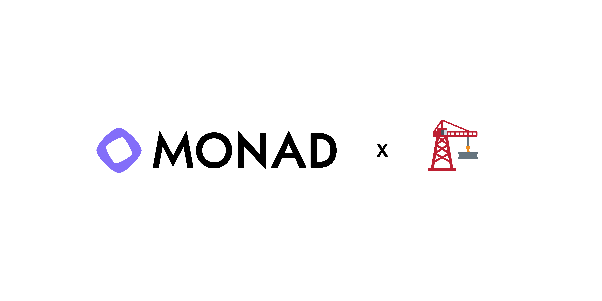
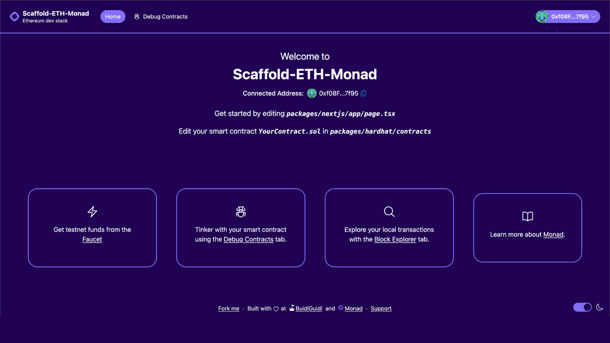

# 🏃 Block Relay

Block Relay is a real-time, team-based onchain relay game built for Monad Blitz Shanghai. Each handoff is an independent transaction on Monad Testnet, while a shared display tracks progress and settles the winning team.

This project starts from the official [Scaffold-ETH-Monad](https://github.com/monad-developers/scaffold-eth-monad) template.

<div align="center">

</div>

<h4 align="center">
  <a href="https://docs.monad.xyz">Documentation</a>
  | <a href="https://github.com/SYSUww/block-relay/issues">Report Issue</a>

</h4>

⚙️ Built using NextJS, RainbowKit, Hardhat, Wagmi, Viem, and Typescript.

-   ✅ **Contract Hot Reload**: Your frontend auto-adapts to your smart contract as you edit it.
-   🪝 **[Custom hooks](https://docs.scaffoldeth.io/hooks/)**: Collection of React hooks wrapper around [wagmi](https://wagmi.sh/) to simplify interactions with smart contracts with typescript autocompletion.
-   🧱 [**Components**](https://docs.scaffoldeth.io/components/): Collection of common web3 components to quickly build your frontend.
-   🔥 **Burner Wallet & Local Faucet**: Quickly test your application with a burner wallet and local faucet.
-   🔐 **Integration with Wallet Providers**: Connect to different wallet providers and interact with the Ethereum network.



## Requirements

Before you begin, you need to install the following tools:

-   [Node (>= v18.18)](https://nodejs.org/en/download/)
-   [Corepack](https://nodejs.org/api/corepack.html) for the repository-pinned Yarn 3.2.3
-   [Git](https://git-scm.com/downloads)

## Quickstart

To get started, follow the steps below:

1. Clone this repo & install dependencies

```sh
git clone https://github.com/SYSUww/block-relay.git
```

2. Open the project directory and install dependencies

```sh
cd block-relay && corepack yarn install
```

3. Start the local chain, deploy the template contract, and start the app in three terminals:

```sh
corepack yarn chain
corepack yarn deploy
corepack yarn start
```

Visit `http://localhost:3000` and use the Debug Contracts page to interact with the local deployment.

## Monad Testnet

Create `packages/hardhat/.env` from the example before deploying to Monad Testnet:

Make a copy of `.env.example` in `packages/hardhat` folder, name it `.env` and enter the respective values

```
DEPLOYER_PRIVATE_KEY=
MONAD_RPC_URL=https://testnet-rpc.monad.xyz
MONAD_CHAIN_ID=10143
```

Use a dedicated Testnet account. Never commit its private key. Deploy explicitly with:

```sh
corepack yarn deploy:testnet
```

For the frontend, copy `packages/nextjs/.env.example` to `packages/nextjs/.env.local`. This switches the frontend from the default local Hardhat network to Monad Testnet:

```
NEXT_PUBLIC_TARGET_NETWORK=monad-testnet
NEXT_PUBLIC_MONAD_RPC_URL=https://testnet-rpc.monad.xyz
NEXT_PUBLIC_WALLET_CONNECT_PROJECT_ID=
```

**What's next**:

-   Edit your smart contract `YourContract.sol` in `packages/hardhat/contracts`
-   Edit your frontend homepage at `packages/nextjs/app/page.tsx`. For guidance on [routing](https://nextjs.org/docs/app/building-your-application/routing/defining-routes) and configuring [pages/layouts](https://nextjs.org/docs/app/building-your-application/routing/pages-and-layouts) checkout the Next.js documentation.
-   Edit your deployment scripts in `packages/hardhat/deploy`
-   Edit your smart contract test in: `packages/hardhat/test`. To run test use `yarn hardhat:test`

## Documentation

Visit our [docs](https://docs.monad.xyz) to learn how to start building with Monad.

To know more about Scaffold-ETH features, check out their [website](https://scaffoldeth.io).
